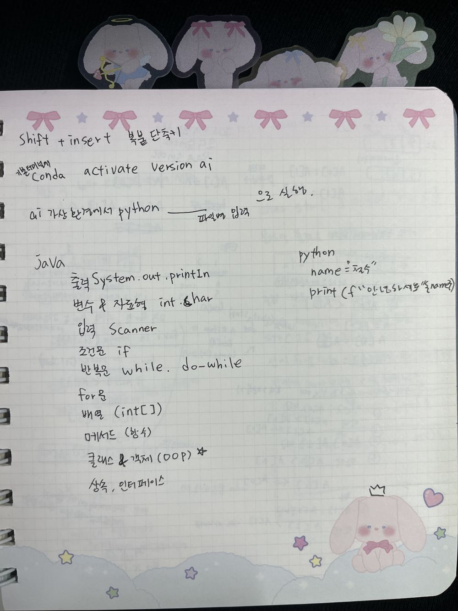
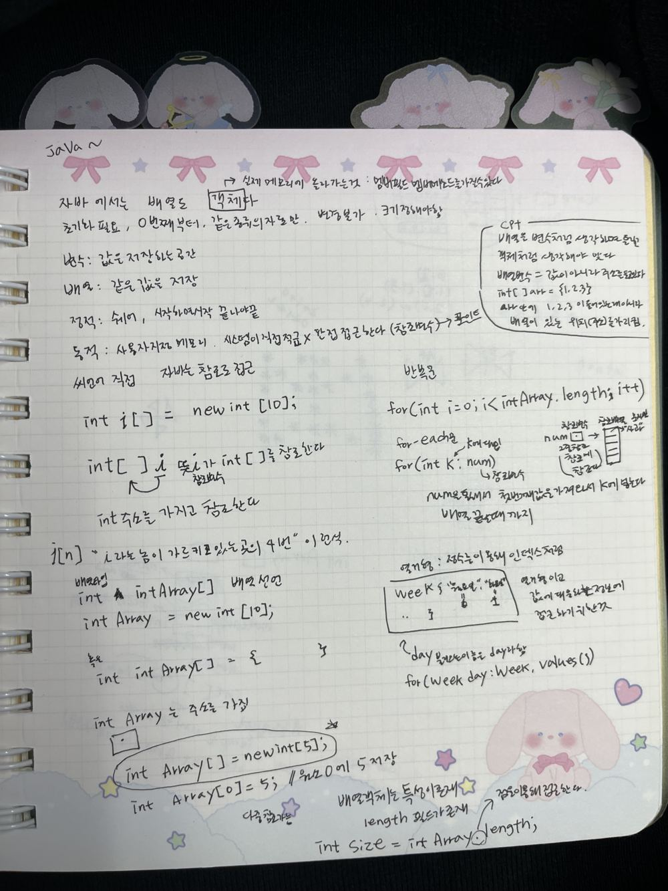
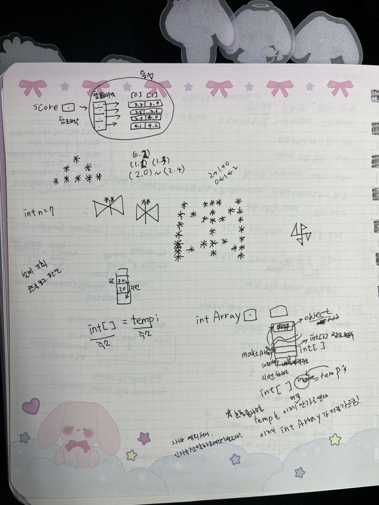
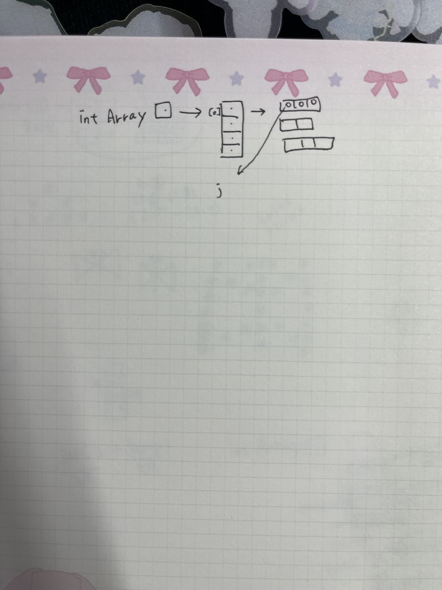

# ☕ Java 수업 손필기 정리

> 화요일 Java 수업 · 관련 코드: [`01_java_basics/`](../01_java_basics)

## 1. 학습 목차

출력 `System.out.println` → 변수와 자료형 `int`, `char` → 입력 `Scanner` → 조건문 `if` → 반복문 `while`, `do-while`, `for` → 배열 `int[]` → 메서드(함수) → **클래스와 객체(OOP) ★** → 상속, 인터페이스

→ 이 순서대로 [`java_test`](../01_java_basics/src/java_test), [`java_test_2`](../01_java_basics/src/java_test_2) 패키지에 실습 코드가 있습니다.

## 2. 배열은 객체다

- 자바에서는 **배열도 객체**다. 그래서 `length` 같은 필드를 가지고, 점(`.`)으로 접근한다.
- 배열의 특징: 초기화가 필요하고, 0번째부터 시작하고, 같은 종류의 자료만 담을 수 있고, 크기를 정해야 하고, 크기를 바꿀 수 없다.
- 변수는 값을 저장하는 공간이고, 배열은 같은 종류의 값을 여러 개 저장하는 공간이다.

| 구분 | 메모리 | 특징 |
|---|---|---|
| 정적 | 스택 | 시작할 때 잡히고 끝날 때 사라짐 |
| 동적 | 힙 (사용자 지정 메모리) | 직접 접근하지 않고 **참조 변수로 간접 접근** ← 포인트 |

- C는 메모리에 직접 접근하고, 자바는 참조로 접근한다.

```java
int i[] = new int[10];   // i는 int[]를 "참조"하는 참조 변수 (주소를 가짐)
// i[4] → "i가 가리키고 있는 곳의 4번 칸"

int intArray[] = new int[5];
intArray[0] = 5;
int size = intArray.length;     // 배열 객체의 length 필드
```

> 💡 배열 변수를 값이 들어 있는 변수처럼 생각하면 안 되고, 객체처럼 생각해야 맞다.
> `int[] arr = {1, 2, 3};` 에서 arr 안에 1, 2, 3이 들어 있는 게 아니라 **배열이 있는 위치(주소)**를 가리킨다.

## 3. 반복문과 enum

```java
for (int i = 0; i < intArray.length; i++) { ... }

for (int k : num) { ... }     // for-each: num에서 값을 하나씩 꺼내 k에 넣음, 배열 끝까지

enum Week { 월, 화, 수, 목, 금, 토, 일 }
for (Week day : Week.values()) { ... }
```

- 열거형(enum): 값에 대응되는 정보에 접근하기 위한 것. 정수를 인덱스처럼 쓸 수 있다. ([`Test3_9_foreachEx`](../01_java_basics/src/java_test/Test3_9_foreachEx.java))

## 4. 2차원 배열 · 참조 · 별 찍기

- 2차원 배열은 **배열의 배열**이다. ([`Test3_10_ScoreAverage`](../01_java_basics/src/java_test/Test3_10_ScoreAverage.java)) `score` 참조 변수 → 참조 배열 → 각 행 배열 (예: 3.3, 3.4 / 3.5, 3.6 ...)
- 행마다 길이가 다른 비정방형 배열도 만들 수 있다. ([`Test3_11_IrregularArray`](../01_java_basics/src/java_test/Test3_11_IrregularArray.java))
- 메서드에서 만든 배열을 `return`하면 `temp`가 아니라 받은 변수(`intArray`)가 그 배열을 직접 가리키게 된다. (주소 = 주소, [`Test3_12_ReturnArray`](../01_java_basics/src/java_test/Test3_12_ReturnArray.java))
- 별 찍기(피라미드, 모래시계, 나비 모양, `int n = 7`): 좌표 (행, 열)로 규칙을 찾으면 쉽다. ([`TEST_3`](../01_java_basics/src/java_test/TEST_3.java), [`Test3_11_3`](../01_java_basics/src/java_test/Test3_11_3.java))

## 필기 원본

<details><summary>펼치기</summary>






> 첫 번째 사진에는 같은 날 적은 Python 내용도 함께 있습니다.
</details>
